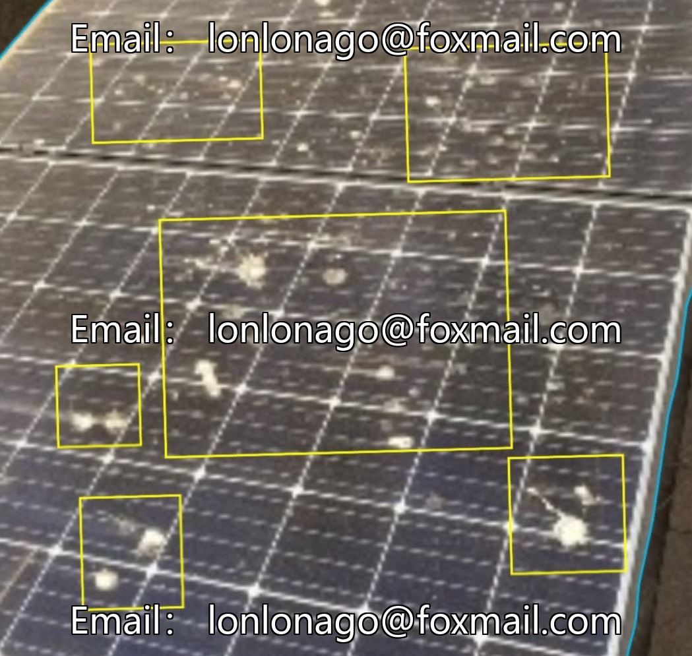
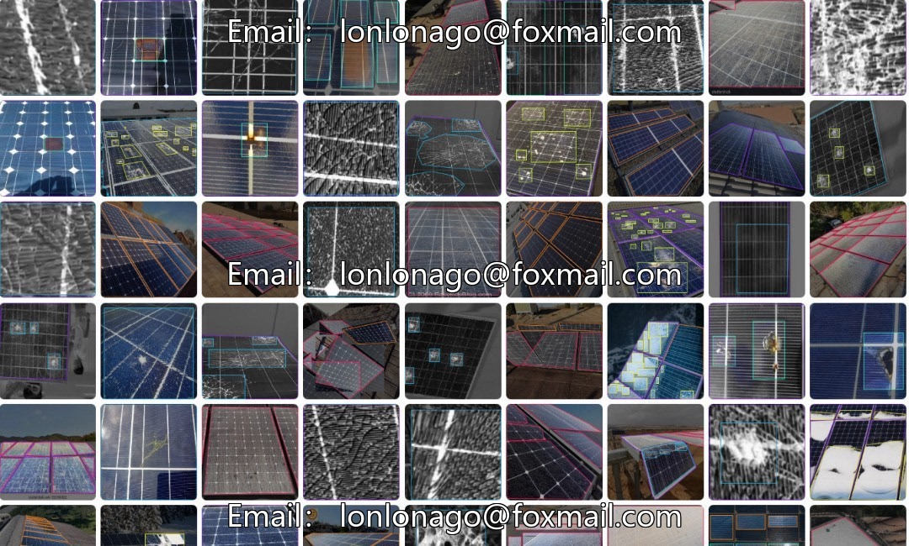
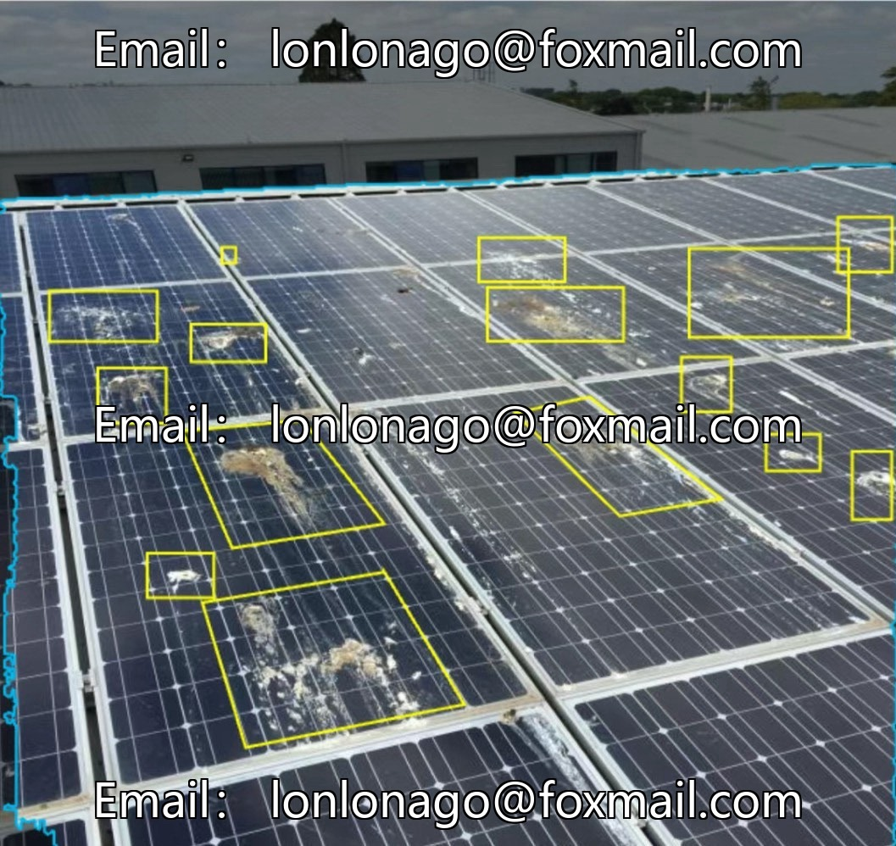
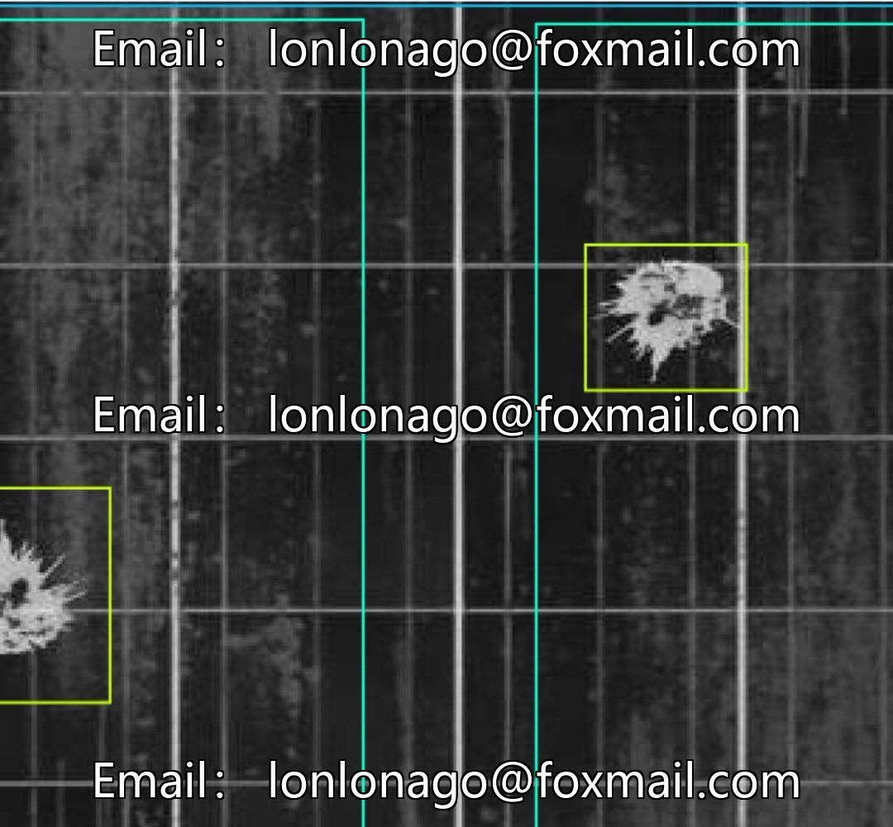
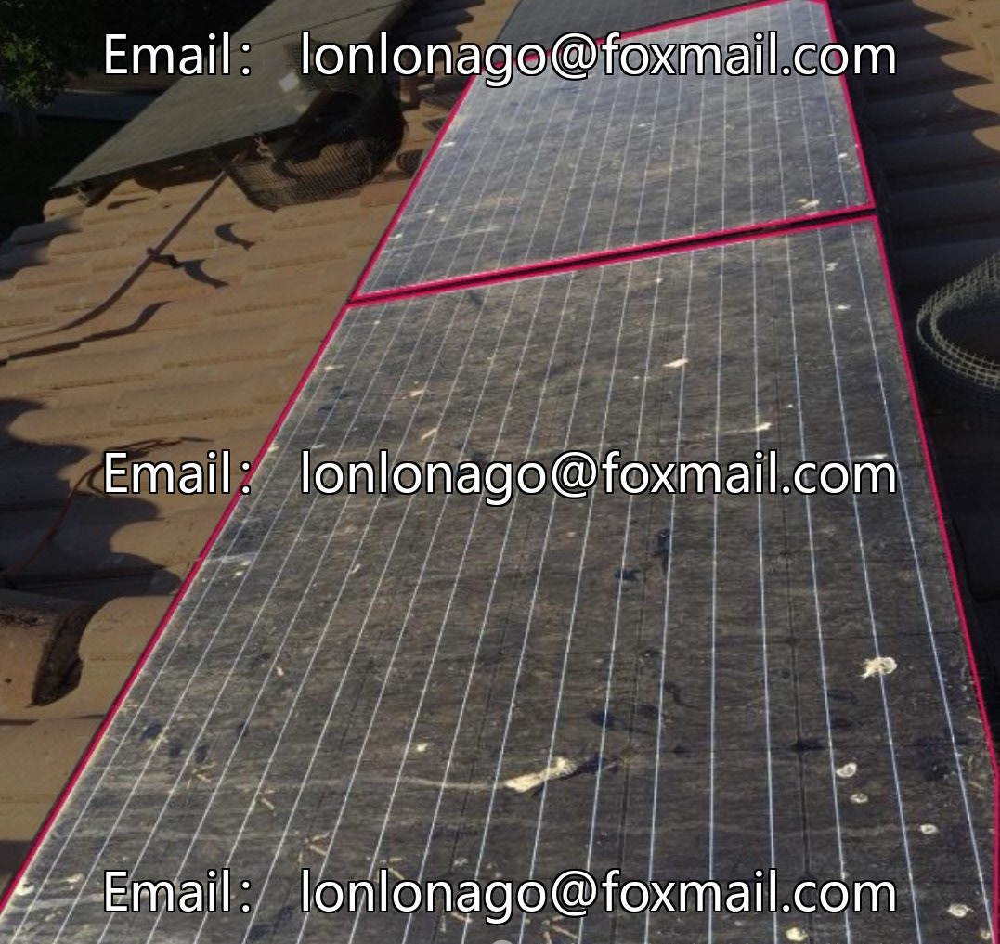
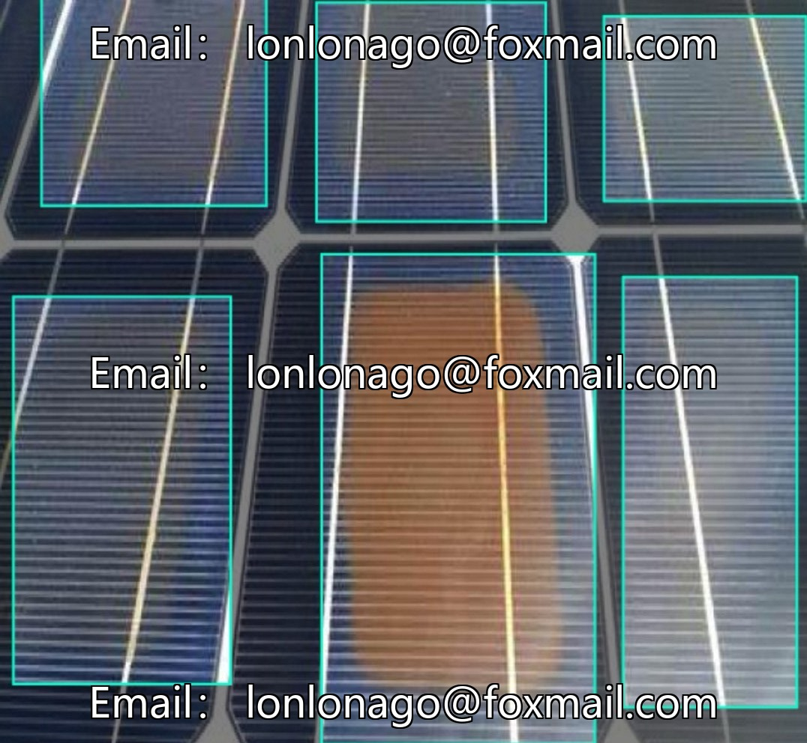

# Drone solar photovoltaic panel defect image dataset, 10340 issue, 760 images

## Body

Drone Solar PV Panel Defect Image Dataset, Issue 10340, 760 images, 7 categories: Bird Drop (Bird droppings), Defective (Defective), Dusty (Dusty), Electrical Damage (Electrical damage), Non Defective (Non-defective), Physical Damage (Physical damage), Snow. Support image format drag and drop upload test, adapts to the input requirements of computer vision models.

The dataset covers common abnormalities and normal states of solar panels, with category divisions aligned with practical application scenarios. It is suitable for the development and training of solar panel defect detection models, aiding in the implementation of automated inspection systems in the photovoltaic industry, enhancing the efficiency of battery board fault identification, providing data support for equipment maintenance, and reducing the cost of manual inspections.

Virtual materials, once sold, are non-refundable.
Interested friends, click "I want" to proceed.

## Images

## Payment

Here is a pay link on Stripe ( https://buy.stripe.com/3cs8yP7sY87d0vu9AB ). Please contact me lonlonago@foxmail.com after funding $89, and I will send you a complete data files , thank you!

